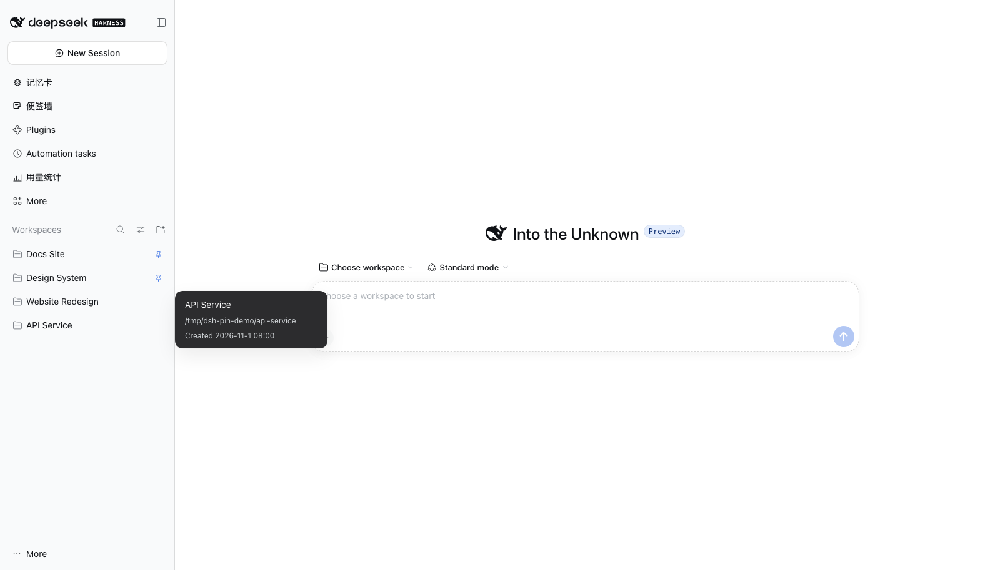
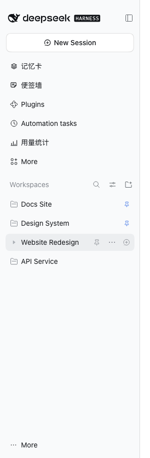
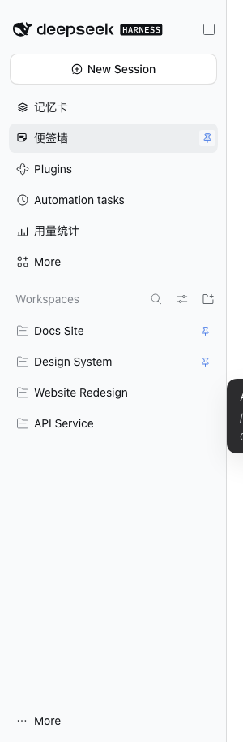
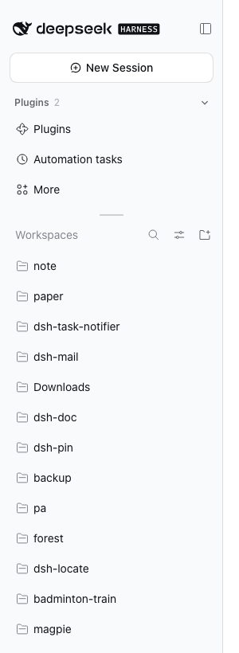

**English** | [中文](./README.zh-CN.md)

# dsh-pin

[](https://www.npmjs.com/package/@polunzh/dsh-pin)
[](https://github.com/polunzh/dsh-pin/actions/workflows/ci.yml)
[](LICENSE)

Pin workspaces and sidebar plugin panels to the top of the [DeepSeek Harness](https://github.com/deepseek-ai/deepseek-harness) sidebar. It also moves the whole plugin panel list above workspace browsing, under a collapsible "Plugins" header that remembers its state. Hover a row, click 📌; click again and the item returns to its exact former slot. Pins survive reloads and restarts.



| Hover a workspace row | Hover a plugin panel row |
|---|---|
|  |  |

The plugin list sits at the top, above Workspaces:



## Install

```bash
dsh plugin --profile desktop add @polunzh/dsh-pin
```

GitHub and local checkouts work too (`github:polunzh/dsh-pin`, `link:/path/to/dsh-pin`), as does the plugin marketplace in DSH settings. Restart DSH or reload the profile afterwards.

## Use

- **Pin a workspace** — hover any row under Workspaces, click 📌. It moves to the top; with several pins the most recent comes first.
- **Pin a panel** — hover any sidebar plugin row (third-party panels, `Plugins`, `Automation tasks`), click 📌. The other panels keep their registration order.
- **Unpin** — click 📌 again, or click the small pin that pinned items always display.

The button matches the native row buttons (24×24 hit area) and never opens or collapses the workspace folder behind it. Pinned rows keep a visible pin so their state reads without hovering.

## Plugin section on top

The whole plugin list move is the same list the host renders — no copy, no second entry per plugin. A small "Plugins" header with a panel count and a chevron for expansion sits above it.

- Click the header, or focus it and press Enter, to collapse or expand the list. The state is stored per browser under `dsh-pin.panel-section.v1`.
- On a first visit the list is expanded on a normal desktop width and collapsed on a narrow one; an explicit choice always wins afterwards.
- Expanded, the list is capped near one third of the sidebar height and scrolls on its own, so a long plugin list never pushes workspace browsing out of reach.
- Collapsing only hides the list — it never changes or closes the selected panel.
- When the sidebar collapses to the 56px icon rail, the header hides and the native icon list shows as before.

## What DSH already ships

| | Built in | dsh-pin adds |
|---|---|---|
| Workspace order | drag only | pin to top |
| Workspace pin state | none | persisted, exact restore |
| Session pin | `pinnedSessionIds` | left alone |
| Panel `order` | fixed at registration | pin to top, ordered per browser |
| Panel pin/unpin | native hover pin (sends the panel to "More") | replaced: native pin hidden, dsh-pin's pin pins to top |

## How it works

- Workspace order uses the host's own `workspaces.insertBefore` RPC, so the durable registry stores it and every client agrees on it.
- Unpinning inserts the item before the workspace that used to follow it; a missing anchor falls back to the end of the list.
- New workspaces are created at the head of the registry. The plugin watches order changes and pulls pins back up, leaving the remaining order alone.
- Panel order is DOM-only: rows get reordered and the order recorded under `dsh-pin.panels.v1`, with unpin restoring slot registration order.
- Moving the list reuses the host's own `nav[class*="panelList"]`: it records a hidden origin marker, then inserts the native `nav` before the workspace branch. If the expected DOM changes, it puts the `nav` back by the marker and leaves the original sidebar working.
- Newer DSH builds ship their own panel unpin pin (a gray filled pin shown on row hover). dsh-pin hides it and draws its own pin, so each row shows a single pin that turns accent-blue when pinned.
- The panel pin sits inside the row's `panelEntry` (a sibling of the row), so plugins that draw their own right-edge content — like dsh-todo's pomodoro countdown — can measure it and shift aside instead of overlapping.
- A `MutationObserver` re-injects buttons after React re-renders and replays panel order.
- The host half is a no-op; all logic lives in `lib/client.js`.

## Limits

- Web GUI and the desktop web layer only; the TUI has no sidebar.
- "Ungrouped" is not a real workspace and cannot be pinned.
- Workspace order is global to the host; panel order is per browser.
- Dragging a pinned item down snaps it back — unpin first.
- Depends on internal DOM (`data-row-key`, `panelRow`/`panelEntry`, React fiber), so a major DSH upgrade can disable the buttons until the selectors are updated. The plugin section fails open: with no matching marker it restores the original layout.
- Debug hook: `window.__dshPin` (`workspaceOrder()`, `panelPins`, `panelSectionCollapsed`, `lastError`, `reassertPins()`).

## Development

```bash
npm test        # pure-logic unit tests (node:test, no dependencies)
npm run build   # regenerate lib/client.js from src/client-src.js
npm run check   # verify the committed bundle matches the source
```

End-to-end tests need a running DSH web instance and headless Chrome reachable over CDP:

```bash
DSH_PIN_LAB_URL="http://127.0.0.1:3091/?token=…" npm run test:e2e     # sidebar DOM and injection contracts
DSH_PIN_LAB_URL="http://127.0.0.1:3091/?token=…" npm run test:pin     # pin button clickability and regressions
DSH_PIN_LAB_URL="http://127.0.0.1:3091/?token=…" npm run test:panel   # top plugin section (placement, collapse, persistence, rail)
```

API contracts and DOM experiments: [docs/API-NOTES.md](docs/API-NOTES.md), [docs/DOM-CONTRACTS.md](docs/DOM-CONTRACTS.md).

## Publishing

CI runs the unit tests and the bundle check. A push to `main` publishes through npm trusted publishing (OIDC) whenever `package.json` carries a new version, so the repo holds no long-lived token.

## License

MIT — see [LICENSE](LICENSE).
