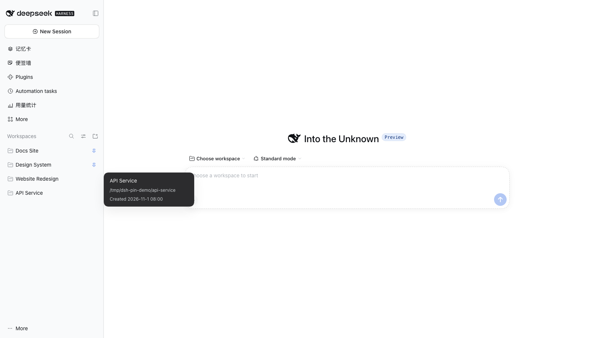
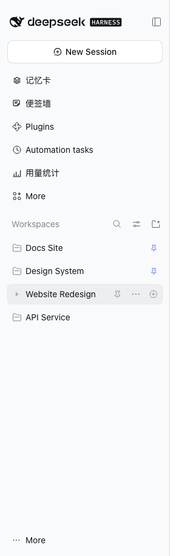
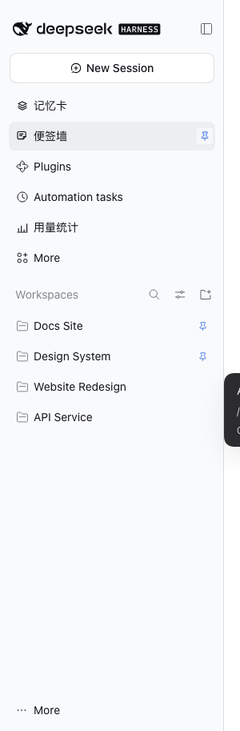

# dsh-pin

[](https://www.npmjs.com/package/@polunzh/dsh-pin)
[](https://github.com/polunzh/dsh-pin/actions/workflows/ci.yml)
[](LICENSE)

**给 [DeepSeek Harness](https://github.com/deepseek-ai/deepseek-harness) 的侧边栏补上真正的「置顶」：Workspaces 置顶 + 插件面板置顶。**

> npm 包名：`@polunzh/dsh-pin` · GitHub 仓库：[polunzh/dsh-pin](https://github.com/polunzh/dsh-pin)

悬停任意工作区行 → 点 📌 钉到 **Workspaces 最上面**；悬停任意插件面板行 → 点 📌 钉到**面板列表顶部**。
再点一次取消置顶，会按记录的前后锚点**精确还原**到原位置；置顶状态持久化，重启/刷新后保持。



| 工作区行悬停：📌 置顶 / 取消置顶 | 插件面板行悬停：📌 置顶 / 取消置顶 |
|---|---|
|  |  |

## 先说结论：DSH 到底支持什么？

写这个插件前，我把运行中的 **DSH Desktop 0.2.2-rc.1**（`/Applications/DeepSeek Harness.app/Contents/Resources/app.asar/dsh/`）解包核对了源码：

| 能力 | 官方支持情况 | 证据 |
|---|---|---|
| **Workspaces** | ✅ 完整支持 | `dsh-workspace`、`dsh-api-workspace-controller`、`dsh-client-ui-workspace` 都挂在 Web 组合里（`@deepseek-ai/dsh-web-app/cordis.patch.yml` 的 `workspace` / `workspace-controller` / `ui-workspace` 行）；侧边栏有 Workspaces 分组、增删改名、拖拽排序、搜索 |
| **Session** | ✅ 完整支持 | `dsh-session`、`dsh-session-persistence-jsonl`、`dsh-api-session-controller`、`dsh-client-ui-session`；侧边栏按工作区分组列出会话，可新建/恢复/归档/搜索 |
| **Session 置顶** | ✅ 支持（工作区内） | `pinnedSessionIds` + `pinSession`/`unpinSession` RPC；`dsh-client-ui-workspace` 的行菜单里有「置顶/取消置顶」，并渲染「已置顶」分组（locale 里 `row.pinned = 已置顶`） |
| **Workspace 置顶** | ❌ 不支持 | 工作区顺序只能靠拖拽（`workspace.insertBefore`），没有「钉到最上面」的入口或状态 |
| **插件面板置顶** | ❌ 不支持 | `sidebar.panellist` 的显示顺序由注册时的 `order` 固定；sidebar 的 pin 回调只用于「隐藏进 More」，**默认 UI 没有任何 pin 控件，且 pin 选择只存在内存、插件重载即丢**（`@deepseek-ai/dsh-client-ui-sidebar/README.md`） |

所以：**Workspaces 和 Session 本身是官方功能，不需要插件补；真正缺的是 Workspaces 的置顶和插件面板的置顶** —— 这正是 `dsh-pin` 补的两件事。

## 功能

- **📌 Workspaces 置顶**：把工作区钉到 Workspaces 列表最上面，多个置顶按「最近置顶优先」排列。
- **📌 插件面板置顶**：把侧边栏插件面板（第三方插件的入口行、内置的「Plugins」「Automation tasks」都行）钉到面板列表顶部，其余面板保持注册顺序。
- **精确还原（多置顶安全）**：取消置顶时按置顶前的相邻锚点插回原位；锚点消失才回退到列表末尾。取消一个不会打乱仍在置顶的其他项。
- **持久化**：工作区顺序写宿主的 Workspaces 注册表（全局生效，所有浏览器/客户端一致）；置顶记录与面板顺序存当前浏览器 localStorage。
- **跟随主题**：按钮和置顶标记只用 `--dsw-*` design token，深浅色/第三方主题都跟随；窄屏（折叠 rail）自动隐藏面板按钮；触屏（无 hover）常显。
- **中英文**：走客户端 `locale` 服务注册 `dsh-pin` 字典。
- **安全**：不新增任何后端路由、不碰会话内容与凭据，只调用宿主已有的 `workspaces.insertBefore` RPC 与浏览器存储。

## 安装

从 npm 安装（推荐）：

```bash
dsh plugin --profile desktop add @polunzh/dsh-pin
```

或从 GitHub 源码安装 / 本地开发：

```bash
dsh plugin --profile desktop add github:polunzh/dsh-pin
# 本地开发
dsh plugin --profile desktop add link:/path/to/dsh-pin
```

也可以在 DSH 的插件市场 / 设置里搜索 `dsh-pin` 安装。安装后重启 DSH（或让插件管理器重载 profile）即可在侧边栏看到 📌 按钮。

> 纯客户端插件：宿主半是 no-op，所有逻辑在 `lib/client.js`。

## 使用

1. **置顶工作区**：鼠标悬停 Workspaces 里的任意工作区行，行右侧出现 📌 → 点击。该工作区移动到 Workspaces 最上面，标题右侧出现置顶标记。
2. **置顶插件面板**：悬停左侧「Plugins / Automation tasks / 第三方面板」的任意一行，行右侧出现 📌 → 点击。该面板移动到面板列表顶部。
3. **取消置顶**：再点一次 📌（工作区也可直接点行右侧的标记）。工作区回到它被置顶前的位置；面板回到注册顺序。
4. 刷新页面 / 重启应用，置顶状态保持。

## 工作原理

```
侧边栏（React）
  ├─ 工作区行 [data-row-key="workspace:<uuid>"]
  │    └─ 注入 📌（追加进行内的 rowActions，悬停可见）
  │         └─ 点击 → ctx.workspaces.insertBefore(id, 当前第一个工作区 id)
  │                   └─ 宿主工作区注册表持久化顺序（全局）
  └─ 插件面板行 button[class*="panelRow"]
       └─ 注入 📌（面板列表内的绝对定位按钮，悬停显示）
            └─ 点击 → DOM 重排 + localStorage 记录
```

- 工作区顺序走 DSH 官方 `workspaces.insertBefore(workspaceId, beforeWorkspaceId?)`：与用户拖拽排序同一条通道，宿主持久化、跨客户端生效。
- 取消置顶的锚点是「置顶前紧跟在它后面的工作区 id」；`insertBefore` 省略锚点即追加到末尾，作为锚点失效时的兜底。
- 插件面板顺序按 `ctx.slots.entriesOfSlot("sidebar.panellist")` 的注册 `order` 还原，所以取消置顶后其他面板顺序不会乱。
- React 会重渲染侧边栏：插件用 `MutationObserver` 兜底重新注入按钮、重放面板顺序，并把置顶状态同步到行属性上。
- 记录键：`dsh-pin.workspaces.v1`（工作区置顶记录）、`dsh-pin.panels.v1`（面板置顶顺序）。

## 边界与已知限制

- 仅 **Web GUI / Desktop 的 Web 渲染层** 可用；TUI / headless 没有侧边栏，插件不生效。
- 「未分组（Ungrouped）」不是真实工作区，不支持工作区置顶（也没有可持久化的顺序）。
- 工作区顺序是**宿主全局**的；面板顺序和置顶记录是**每浏览器本地**的（DSH 没有「面板置顶」的宿主概念）。
- 平铺/树形等视图切换不影响工作区顺序，但工作区的**组内**显示顺序仍由 DSH 自身的排序模式决定。
- 依赖应用内部 DOM 结构（`data-row-key`、`panelRow`、React fiber 取面板 id）。DSH 大版本升级后如果结构变化，按钮可能暂时失效 —— 升级/适配后即可恢复，不会破坏应用本身。
- 调试：客户端暴露只读诊断钩子 `window.__dshPin`（`workspaceOrder()`、`workspaceRecords`、`panelPins`、`lastError`）。

## 开发

```
src/client-src.js        客户端源码（含构建占位符）
lib/pin-core.mjs         纯逻辑核心（置顶计划 / 记录解析 / 面板排序，Node 可测）
lib/client.js            客户端 bundle（由 build 生成，勿手改）
lib/index.js             宿主半（no-op）
scripts/build-client.mjs 构建（内联 pin-core + 校验语法）
test/pin-core.test.mjs   纯逻辑单测（node:test，零依赖）
docs/API-NOTES.md        DSH 客户端插件 API 契约笔记
docs/DOM-CONTRACTS.md    侧边栏 DOM / React 契约与 E2E 实验记录
test/e2e/                CDP 端到端脚本（需要跑着的 DSH 实例）
```

```bash
npm test          # 纯逻辑单测
npm run build     # 重新生成 lib/client.js
npm run check     # 校验 lib/client.js 与源码同步
```

E2E（需要一台跑着的 DSH web 实例 + headless Chrome CDP；会真实点击 📌 并断言顺序/持久化/还原）：

```bash
DSH_PIN_LAB_URL="http://127.0.0.1:3091/?token=…" npm run e2e
# 可覆盖：DSH_PIN_CDP=http://127.0.0.1:9222 DSH_PIN_TARGET=127.0.0.1:3091
```

更多实现细节见：

- [docs/API-NOTES.md](docs/API-NOTES.md) —— DSH 0.2.2 客户端插件契约（加载格式 / inject / effect / workspaces RPC / 面板 slot / locale / patch / design token）
- [docs/DOM-CONTRACTS.md](docs/DOM-CONTRACTS.md) —— 侧边栏 DOM 与 React fiber 契约、重排稳定性实验、注入约定

## 发布与 CI

- CI（`.github/workflows/ci.yml`）：`npm test` + `npm run check`（校验提交的 client bundle 与源码同步）。
- 发布（`.github/workflows/publish.yml`）：push 到 `main` 时，若 `package.json` 的版本还没发布过，就用 npm **trusted publishing（OIDC）** 自动发布；仓库里不存放长期 token。本包已配置好 trusted publisher（repo `polunzh/dsh-pin` + workflow `publish.yml`），bump 版本后 push 即可自动发版。
- 如需首次接管一个新包名：先用带 scope 写权限的 token 手工 `npm publish --access public` 一次，再运行 `npm trust github <pkg> --file publish.yml --repo polunzh/dsh-pin --allow-publish` 登记 trusted publisher。

## 许可

MIT，见 [LICENSE](LICENSE)。
