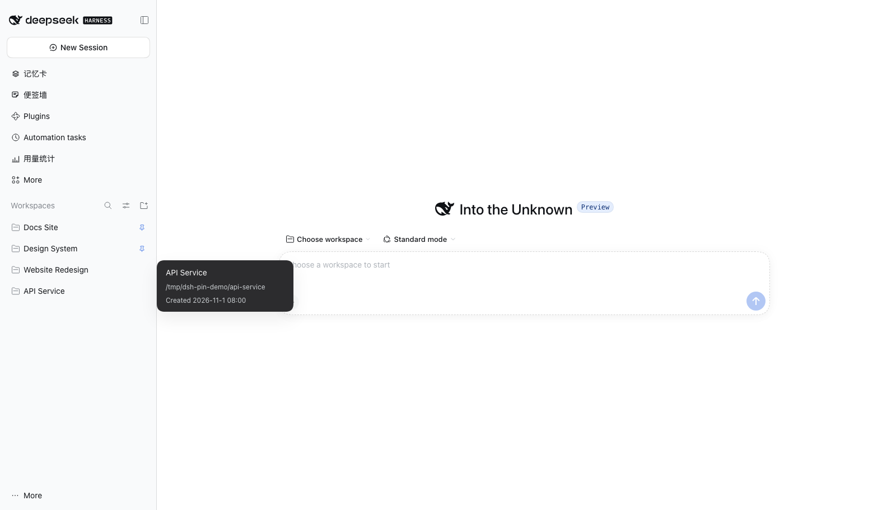
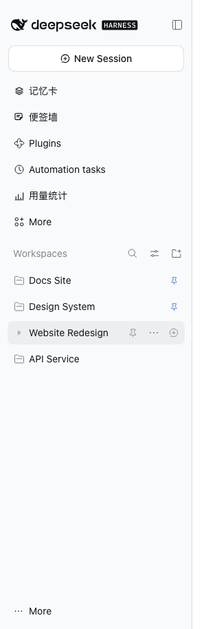
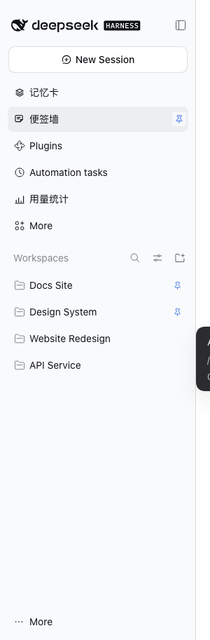

**中文** | [English](./README.md)

# dsh-pin

[](https://www.npmjs.com/package/@polunzh/dsh-pin)
[](https://github.com/polunzh/dsh-pin/actions/workflows/ci.yml)
[](LICENSE)

把工作区和侧边栏插件面板钉到 [DeepSeek Harness](https://github.com/deepseek-ai/deepseek-harness) 侧边栏顶部。悬停行、点 📌 即可置顶；再点一次，回到置顶前的位置。刷新和重启后保持。



| 工作区行悬停 | 插件面板行悬停 |
|---|---|
|  |  |

## 安装

```bash
dsh plugin --profile desktop add @polunzh/dsh-pin
```

也可以从 GitHub（`github:polunzh/dsh-pin`）、本地目录（`link:/path/to/dsh-pin`）安装，或在 DSH 设置里的插件市场搜索安装。装完重启 DSH 或重载 profile。

## 使用

- **置顶工作区** — 悬停 Workspaces 里的任意一行，点 📌，该工作区移到最上面；多个置顶按最近置顶优先排列。
- **置顶面板** — 悬停侧边栏任意插件行（第三方面板、`Plugins`、`Automation tasks`），点 📌，该面板移到面板列表顶部，其余面板保持注册顺序。
- **取消置顶** — 再点一次 📌，或点已置顶行上常驻的小图钉。

按钮和原生行内按钮同尺寸（24×24 热区），点击不会连带展开或折叠所在的工作区文件夹。已置顶的行常显一个小图钉，不用悬停也能看出状态。

## DSH 自带的能力

| | 官方现状 | dsh-pin 补的 |
|---|---|---|
| 工作区顺序 | 只能拖拽 | 钉到顶部 |
| 工作区置顶状态 | 没有 | 持久化，取消时精确还原 |
| 会话置顶 | `pinnedSessionIds` | 不碰 |
| 面板 `order` | 注册时固定 | 钉到顶部，按浏览器记录顺序 |

## 工作原理

- 工作区顺序走宿主的 `workspaces.insertBefore` RPC，由持久注册表保存，所有客户端一致。
- 取消置顶时插回「置顶前紧跟在它后面的工作区」之前；锚点已不存在就追加到列表末尾。
- 新建工作区会插到注册表最前。插件监听顺序变化，只把置顶项拉回顶部，其余顺序不动。
- 面板顺序只走 DOM：重排行并把顺序记到 `dsh-pin.panels.v1`，取消置顶时按 slot 注册顺序还原。
- React 重渲染后由 `MutationObserver` 重新注入按钮并重放面板顺序。
- 宿主半是 no-op，逻辑全在 `lib/client.js`。

## 边界

- 只适用于 Web GUI 和桌面端的 Web 渲染层；TUI 没有侧边栏。
- 「未分组（Ungrouped）」不是真实工作区，不能置顶。
- 工作区顺序是宿主全局的；面板顺序按浏览器本地。
- 把置顶项往下拖会被自动拉回，想换位置先取消置顶。
- 依赖应用内部 DOM（`data-row-key`、`panelRow`、React fiber），DSH 大版本升级后按钮可能失效，适配选择器即可恢复。
- 调试钩子：`window.__dshPin`（`workspaceOrder()`、`panelPins`、`lastError`、`reassertPins()`）。

## 开发

```bash
npm test        # 纯逻辑单测（node:test，零依赖）
npm run build   # 由 src/client-src.js 重新生成 lib/client.js
npm run check   # 校验提交的 bundle 与源码一致
```

端到端测试需要一台跑着的 DSH web 实例，以及可通过 CDP 连接的 headless Chrome：

```bash
DSH_PIN_LAB_URL="http://127.0.0.1:3091/?token=…" npm run test:e2e   # 侧边栏 DOM 与注入契约
DSH_PIN_LAB_URL="http://127.0.0.1:3091/?token=…" npm run test:pin   # 置顶按钮可点击性与回归
```

API 契约与 DOM 实验记录：[docs/API-NOTES.md](docs/API-NOTES.md)、[docs/DOM-CONTRACTS.md](docs/DOM-CONTRACTS.md)。

## 发布

CI 跑单测和 bundle 校验。push 到 `main` 后，若 `package.json` 的版本是新的，就走 npm trusted publishing（OIDC）自动发布，仓库里不放长期 token。

## 许可

MIT，见 [LICENSE](LICENSE)。
